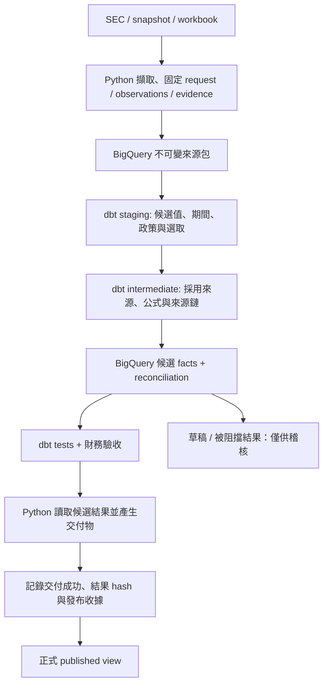

# 財務計算遷移規格：Python → dbt／BigQuery

日期：2026-11-07。架構方向已採納；本文件是待實作規格，不代表已部署、已比對或已批准新的財務定義。依據 [ADR-0001](../adr/0001-dbt-bigquery-financial-authority.md) 及 [術語表](../../GLOSSARY.md)。適用新版 Loan Review 的 cloud 路徑；Legacy 不作為公式來源。

## 執行進度（2026-11-07）

最新進度見 [隔離 A→J 串接與驗證](full-workflow-validation-20261111.md)：2026-11-12 已接上來源包實體保存、dbt 財務驗收、完整交付、驗證發布收據與 published views。使用者選擇隔離驗證部署；政策只允許合成資料，不能解讀為正式 authority／BI 已切換。以下日期段落保留各階段當時的狀態；q18 精度規則後續已核准實作，正式 M4／M5 仍未放行。

使用者選擇「先保留精度待定，只做影子比對」。已新增可獨立執行的 dbt shadow path 與隔離 BigQuery 驗證；**未切換正式 authority，也未完成 M3–M5**。目前的 source selection／算式 shadow 與診斷對帳不等於完整財務驗收 SQL。參見 [操作手冊](dbt-shadow-runbook.md) 與 [驗證紀錄](dbt-shadow-validation-20261107.md)。

### 2026-11-09 後續進度

在不切換 authority／不核准精度的前提下，新增來源／精確加減差異的嚴格分類、run／source／plan 綁定、SQL 結構化對帳覆核及來源精度上限。支援部分覆核並保留未覆核狀態；對帳 verified 仍不代表整份報告 accepted 或 published。見 [後續驗證](dbt-shadow-validation-20261109.md)。

### 2026-11-10 整合入口

一般報告入口新增 `--shadow-reconciliations`，把結構化覆核資料傳入隔離 shadow 流程，沿用既有保存、hash 與比較紀錄。僅允許 dbt-shadow 模式；正式 Report／Python 驗收不採用此輸入，精度與切換仍未放行。用法見 [操作手冊](dbt-shadow-runbook.md)。本次改動為 Python 調度與 CLI 接線，未修改 SQL，也未重新執行雲端驗證。

### 2026-11-10 consumer 與 SQL readiness

後續新增 SQL 財務 readiness／必要格子與覆核 coverage 比較，以及內容綁定的計算收據和 BigQuery 結果快照 reader。可直接以 dbt 數字產生 MD／JSON／HTML 候選預覽，不以 Python 公式補值。既有 Python renderer 的算術驗證保持不變，兩個經過各自驗證的入口共用純呈現程式碼。另修正 SQL 除法，使 BIGNUMERIC 溢位必須失敗而非轉成一般 NULL。

這是 M3 的部分實作，仍非正式 authority reader／publication。ratio commentary、identity 採用、完整測試矩陣、Excel、正式發布與回退仍待完成；未核准精度，未切換。見 [驗證紀錄](dbt-shadow-validation-20261110.md)。

### 2026-11-10 敘述計算後續

候選路徑已將跨期增減／成長率、比率分子分母比較、資產負債組成選取／排序／加總／殘差／重疊檢查移至 dbt。Python adapter 只轉接數字與組文，既有 Python 計算僅作影子基準；cloud 預設尚未切換。收據 v2 綁定敘述結果與原始文件，保留 v1 快照讀取；原始 normalization 的中間值／quantum 無損 preflight 亦已補強。見 [敘述驗證](dbt-shadow-commentary-validation-20261110.md)。

### 2026-11-10 Excel 候選交付

新增收據綁定的 `--excel` 候選匯出。Review 引用 Warehouse 的固定 dbt 結果；Sources 是獨立的本機試算，不能改寫主表或倉儲。完整十進位字串與 Excel binary64 近似值分開保存，並檢查實際存檔的 496 個 Facts、324 個主表綁定。候選與既有 Python 活頁簿的實際匯出／重算、失敗注入及回歸共 291 項測試全數成功，沒有略過。仍未取得正式發布／切換資格，原生 Excel 尚未執行。見 [Excel 驗證](dbt-shadow-excel-validation-20261110.md)。

### 2026-11-10 候選雲端保存與讀回

新增隔離 BigQuery archive：完整計算檔案、Facts、來源證據、有序依賴、對帳、readiness 與敘述結果綁定 run／attempt、內容 digest 及計算收據。相同 attempt 重試不得追加或覆寫；typed views 與 reader 逐項核對固定快照。三份合成案例共 496 個 Facts 實際讀回成功，四種損壞案例均被 reader 與 dbt 拒絕，完整回歸 300 項通過。

這是 M3 保存與讀取基礎；不是正式發布。表仍七天到期，尚無正式保留政策、published consumer IAM、發布收據或回退流程。所有 precision／publication 旗標仍為 false。見 [候選保存驗證](dbt-candidate-archive-validation-20261110.md)。

### 2026-11-10 identity 基準修正

遷移檢查發現 Python `calculate_identity()` 曾允許覆寫 conflict／not_applicable，與 SQL 保存這些狀態的規則不一致。已改成明確拒絕，保留原來源結論；不為了對齊基準而讓 SQL 接受此錯誤。新增六個 DER 公式的獨立手算預期、signed tax、缺值、來源衝突／不適用與反向推算測試。這是基準修正，不是 SQL identity 採用已完成；現有計算歷史與收據不改寫，新執行需記錄新的 code hash。

驗證：`REVIEW_EXCEL_TEST=1 python -m unittest discover -s tests` 完整 308 項測試成功、無略過，包含實際 Excel 匯出／重算；不是重新執行 BigQuery 計算的證據。

SQL identity 接入仍需傳入並保存結構化覆核、完整有序依賴與 definition evidence，計算前自行檢查同期間／範圍／單位、來源狀態及依賴循環，再讓 downstream 比率依正確拓樸順序重算。不能僅開啟 DER kernel macro 即視為已遷移。

### 2026-11-10 DER 影子採用

後續已將來源綁定的個別 identity 覆核接入 plan、SQL、baseline 及收據 reader；未提供覆核時仍不推算。六個 DER 的本機手算／契約檢查通過，四份 BigQuery 原生案例涵蓋毛利、signed tax、Quarterly YTD 營業利益與連續推算至比率，共 682 個 Facts。Fact／對帳／readiness／commentary 未知 mismatch 皆為零；數值精度差異照實保留。禁用 Python 財務計算函式後四份仍能完整讀回。見 [identity 驗證](dbt-shadow-identity-validation-20261110.md)。CASH-CHANGE 採用、其餘 native 失敗矩陣與正式發布／回退仍未完成，不代表 M2–M5 全部通過。

### 2026-11-10 CASH-CHANGE 影子採用

後續新增 preliminary facts → SQL 完整橋接驗證 → 最終 Facts 的採用順序。只有通過橋接且 definition evidence 相符，才由 BigQuery 算 ending−beginning。三份隔離原生案例覆蓋 Annual 成功、偽造／不完整覆核拒絕及 Quarterly 不新增現金列，共 496 個 Facts；未知 mismatch 均為零，精度差異仍未放行。最終完整回歸 319 項通過。見 [現金變動驗證](dbt-shadow-cash-validation-20261110.md)。正式發布、完整邊界矩陣、回退及 M4 核准仍待完成。

### 2026-11-10 候選交付雲端保存

新增收據綁定的交付驗證與隔離 GCS transport：上傳前重新驗證呈現內容及 Excel，使用 create-only objects、固定 generation 與 SHA256，最後寫交付 commit。實際保存／讀回 10 份合成交付物，相同 ID 重試收據不變；四項 native 拒絕案例通過，原 commit 保持不變。完整回歸 324 項通過。見 [交付保存驗證](dbt-delivery-storage-validation-20261110.md)。這仍不是正式 publication registry，永久保存、IAM、release／rollback 與精度切換均未放行。

### 2026-11-10 SQL-only 候選入口

新增不執行 Python baseline 的候選 runtime，輸入準備、SQL、收據與呈現可在禁用 24 個 Python 財務／比較函式時完成。Annual／Quarterly 原生案例共 310 個 Facts，包含 identity、現金橋接與故意污染舊 selected values 的測試。新收據綁定 request_hash，明確記錄 comparison not_run；這次不是 migration comparison，不宣稱零差異。完整回歸 327 項通過。見 [SQL-only 驗證](dbt-only-execution-validation-20261110.md)。仍限隔離 namespace；正式引擎與發布預設未切換。

### 2026-11-11 SQL 公式與必要核准契約

新增 dbt 內的公式／目標／有序輸入／單位註冊表與必要 decisions 定義，從 request 自行核對期間。計畫不能靠交換科目、錯年度、改公式、刪輸入，或刪除 DEC-03 來產生可接受數字。兩個正常原生案例共 310 個 Facts 通過，五個故障目標皆由 SQL 拒絕且維持 NULL；完整回歸 328 項成功。見 [公式與政策驗證](dbt-formula-policy-validation-20261111.md)。canonical 配置、完整來源／邊界矩陣與正式發布／回退仍待完成；不切換預設。

### 2026-11-11 SQL canonical 設定

新增 SQL configuration dimension，固定 scale、Standard EBITDA basis、公式／政策／未核准精度版本；producer 的 declared 欄位不能自行改變計算規則或核准精度。三種原生竄改案例皆由 test 拒絕，SQL 保留 canonical 原始值；同版本的 Annual／Quarterly shadow 比對未知 mismatch 為零，精度差異 26／18 仍待核准。完整回歸 329 項成功。見 [設定驗證](dbt-configuration-validation-20261111.md)。

整體尚未完成，下一階段依 [完成條件矩陣](dbt-migration-completion-matrix.md) 追蹤所有原規格缺口；不是只剩精度核准，也不先要求正式切換。

### 2026-11-11 候選 release 控制與回退

新增不可覆寫的候選 release／event／run binding 與 GCS generation CAS selector。兩個實際計算版本完成 A→B→rollback A 控制測試，舊 logical run bindings 不變；stale CAS、未曾選用版本回退、release 覆寫及 precision promotion 均拒絕。這尚未接入固定程式套件／真正財務 runtime，也不是 M4 核准。見 [候選版控驗證](dbt-candidate-release-validation-20261111.md)。正式 publication registry、IAM、永久保存與剩餘完成矩陣仍待完成。

### 2026-11-11 固定程式套件與舊版本實跑

新增 deterministic candidate runtime ZIP、Python binary／相依版本與內容鎖、安全解壓及隔離執行。A／B 兩個實際程式指紋各自完成 BigQuery 計算，分別執行 16／17 models、各 186 Facts；舊 A 沒有讀到工作目錄新版，B 原收據也未改寫。A／B SQL 契約欄位逐一相同；這不是 Python 比對或精度放行。完整回歸 343 項成功。見 [固定套件驗證](dbt-runtime-package-validation-20261111.md)。selector 與 runtime 儲存／載入尚未整合，正式發布與整體完成矩陣仍待補齊。

### 2026-11-11 候選選版執行與回退

第 1 項選版／執行接線已補齊候選流程：固定 GCS runtime generation、隔離執行、SQL 前 immutable run binding，並完成原生 A → B → rollback A。三次各 186 Facts，既有收據未覆寫，A 與回退 A 的完整 Facts 排除 run ID 後相同。完整回歸 349 tests、OK。實作、證據 pins 與限制見 [選版執行驗證](dbt-selected-runtime-validation-20261111.md)；完成範圍以 [完成矩陣](dbt-migration-completion-matrix.md) 為準。精度仍待定、僅候選驗證，沒有正式 authority 或 publication 切換。

### 2026-11-11 核准 q18 精度方案並完成候選驗證

使用者核准除法結果 18 位小數、HALF_EVEN、canonical parents 與 exact equality；正式上線另行放行。已新增 dbt 精確除法 UDF、獨立 Fraction oracle、逐 Fact audit 與 canonical comparison gate。年度／季度與舊 Python 的差異保留，新政策參考值要求完全一致；詳見 [精度驗證紀錄](dbt-q18-precision-validation-20261111.md)。候選的 `precision_approved=false` 保留既有正式 release gate，並以 `precision_policy_implementation_approved=true` 表示已獲本次規則實作核准，兩者不可混用。

### 2026-11-11 Loan Review skill 串接

自然語句 skill 已接到固定 q18 套件、dbt／BigQuery、同收據報告／Excel、BigQuery archive 與 GCS delivery。已安裝自動辨識入口；缺公司／mode／期間時先補齊意圖，資料完整就執行。合成 Annual 全流程與 367 項回歸通過，仍產出候選 draft，未變更正式 CLI／HTTP 的權威來源；見 [skill 串接驗證](loan-review-skill-integration-validation-20261111.md)。

## 1. 現況與要解決的問題

目前 `review_workflow.run_review()` 透過 `agent_runner.prepare_loan_review_source_stage()` 取得 SEC／snapshot／BigQuery／受限 workbook 來源。`loan_review_sources.prepare_source_inputs()` 已先做期間與版本選取，再由 `ReviewCloud.stage_bundle()` 將 metadata、inputs、evidence 寫入 `raw_review_sources`，經 dbt source view 讀回核對。

`loan_review_pipeline.complete_report()` 執行政策、採用來源、計算、比較敘述與驗收；`loan_review_contract.approved_formula_value()`、`calculate_fact()`、`calculate_identity()` 定義公式與門檻。正式 dbt views 目前拆出已由 Python 計算的 `raw_review_results`，並未重新計算財務公式。

本次需把「可重用的財務轉換」移到倉儲，而不是只把最末的除法翻譯成 SQL。尤其現有 source bundle 的 inputs 已經過 Python 選取，不能直接將其視為未加工來源而宣稱來源選取已遷移。保留 evidence 中的完整候選值與 excluded／superseded 決策，並建立原始觀察值契約。

既有規則仍適用：`references/loan-review-acceptance-spec-v1.0.md`、`references/output-format.md`、`references/loan-review-calculation-implementation.md`。本規格不覆寫它們的財務定義。

## 2. 責任邊界

| 工作 | 目標權責 | 驗證責任 |
| --- | --- | --- |
| API、文件解析、snapshot／workbook adapter | Python；保留原始數字字串、來源版本與定位 | 擷取 schema、身分、格式與來源完整性 |
| 確認需求、政策與公司個別定義 | 使用者／可追溯覆核證據；Python 接收並保存 | dbt 檢查規則是否存在、適用、過期或衝突；不自行核准 |
| as_of、版本選擇、單位／scale、財期配對 | dbt | 候選值、排除理由及選取決策測試 |
| 財務計算、缺值傳遞、財務對帳 | dbt SQL，由 BigQuery 執行 | dbt tests＋獨立預期值 fixtures |
| 原因說明、模型呼叫 | Python | 仍引用 canonical facts／原文；模型不能改財務值 |
| Report 結構、Markdown／HTML／Excel | Python | schema、排列、引用、格式與交付物驗證 |
| 正式發布資格 | 調度程式整合 dbt、財務驗收與交付結果 | 發布 view 的資格 JOIN 與失敗注入測試 |

cloud 切換後 Python 只能採用該 run 已驗證的 dbt facts，不得用 `calculate_report()` 或另一套敘述計算補數。`validate_arithmetic()` 目前會用 Python 算式要求精確相等，必須改成版本化的 warehouse 驗證收據核對／結果綁定；獨立算術重算保留在遷移比對與測試中，不作雲端另一個權威。

`ratio_commentary_analysis.py` 也含增減額、成長率及分子／分母比較。雲端中這些衍生數字亦須由 dbt 提供，Python 只組文；避免主表已遷移、敘述卻另算一套。Excel 公式可保留供使用者本機試算，但須與輸出 run 比對，編輯後不自動回寫倉儲。

## 3. 目標資料流與落地

下面是**擬新增**名稱，不是目前已存在的物件；實作可在不破壞契約下調整命名，必須同步更新文件及 consumers。

| 層 | 擬新增物件 | 內容／物化 |
| --- | --- | --- |
| raw | `raw_review_observations`、`raw_review_requests`、`raw_review_policies` | append-only；完整 observation、request／calendar、政策與公司定義證據。保留現有 `raw_review_sources` 相容路徑 |
| staging | `stg_review_observations`、`stg_review_periods`、`stg_review_policies` | views；typed 欄位與解析診斷；不以去重吞掉同 key 不同 payload |
| intermediate | `int_review_source_selection` | as_of、版本、概念、scope、unit 與期間配對；輸出採用／排除／衝突 |
| intermediate | `int_review_adopted_facts`、`int_review_calculated_facts` | 來源值、派生值、狀態、公式／input_ids；依公式依賴拓撲計算 |
| audit | `review_fact_candidates`、`review_reconciliation_candidates`、`review_calculation_receipts` | 不可變實體表，依 run／attempt 保存；失敗也可稽核 |
| presentation | 現有 `fct_loan_review_facts` 等 views 的相容轉接 | 指向固定的 canonical run 結果；不能藉 rebuild 重算歷史已發布值 |
| publication | `fct_loan_review_published_facts` | 只開放完整發布成功的 run；正式報告／BI 指向此層 |

計算 identity 至少包含 `(run_id, entity, calculation_attempt_id, fact_id)`；每個 attempt 綁定同一個 source bundle hash、request hash、formula／policy／precision version、code commit、dbt invocation ID。只有完整且驗證過的 attempt 可被選為該 run 的候選版本。新的來源或公式需新 run；同 run 的基礎設施重試不得混入不同內容。

跨多表寫入不假設自動原子化：最後才寫 publication receipt，該 receipt 必須列明全部必要表／交付物 hashes 與固定 attempt。重試按內容鍵冪等；同鍵不同內容直接失敗。消費端用完整身份 JOIN，禁止只取每張表各自的最新列。

## 4. 計算契約與公式清單

依據目前 `METRICS` 與公式引擎。保留 metric、formula ID、輸入順序、符號與既有 formula version；不可用名稱相近的 Legacy 指標替換。

| ID | 指標 | 有序輸入／公式 | 額外條件 |
| --- | --- | --- | --- |
| CF-01 | current_ratio | current_assets / current_liabilities | 同一時點；沿用目前 percent 單位 |
| CF-02 | quick_ratio | quick_assets / current_liabilities | DEC-01；不可用 current_assets 或任意扣 inventory 代替 |
| CF-03 | cash_flow_ratio | cfo / current_liabilities | CFO 是請求 duration、負債為對應期末 instant |
| CF-04 | interest_coverage | (pretax_profit + interest_expense) / (interest_expense + capitalized_interest) | DEC-05；gross interest、不淨額、不重複 |
| CF-05 | ebitda_interest | (pretax_profit + interest_expense + da) / (interest_expense + capitalized_interest) | 不是任意 EBITDA / interest；DEC-05 |
| CF-06 | debt_ratio | total_liabilities / net_worth | DEC-02；不是 total_liabilities / total_assets |
| CF-09 | revenue_growth | (current revenue − previous revenue) / previous revenue | 年度前一 FY；季度同期間前一 YTD；前值為負照現行 signed 分母，不改 ABS |
| CF-10 | gross_margin | gross_profit / revenue | 同一完整 duration |
| CF-11 | operating_margin | operating_income / revenue | 同一完整 duration |
| CF-12 | pretax_margin | pretax_profit / revenue | 同一完整 duration |
| CF-16 | operating_margin_change | current operating_margin − previous operating_margin | 儲存 fraction 差，顯示乘 100 為百分點 |
| COMMON-SIZE-v1 | 表格占收入比 | 指定科目 / 同期間 revenue | fact_id 保留 pct 角色，不新造 metric |
| CASH-CHANGE-v1 | cash_change | ending_cash − beginning_cash | 需完整同基礎 cash bridge 與 definition evidence |
| STANDARD-EBITDA-v1 | ltm_ebitda | net_income + interest_expense + income_tax + da | 四項完整 exact LTM、DEC-05／06、核實 basis |
| LEVERAGE-v1 | total_leverage | total_debt / ltm_ebitda | 期末 debt 與相應 LTM；繼承 EBITDA basis；DEC-02／06 |
| DER-01 | gross_profit | revenue − cost_of_revenue | 完整同 scope identity 覆核證據 |
| DER-02 | cost_of_revenue | revenue − gross_profit | 同上 |
| DER-03 | operating_expense | gross_profit − operating_income | 同上，營業費用不包含 cost_of_revenue |
| DER-04 | operating_income | gross_profit − operating_expense | 同上 |
| DER-05 | pretax_profit | net_income + income_tax | 稅務利益保留負號；需確認 NCI／停業項目 scope |
| DER-06 | net_income | pretax_profit − income_tax | 同上 |

`total_debt`、`quick_assets`、`net_worth` 依核實定義採用來源；不是把名稱相似的 XBRL tags 無條件加總。`debt_service`／`dscr` 的 DEC-03 仍未解決，不新增 DSCR 算式、不用 CapEx 當本金，繼續保留不可用狀態並阻擋適用的驗收。

LTM 第一版遷移保留目前「完整 exact interval 的四項構成」規則；不增加前 FY＋本期 YTD−去年同期 YTD 的新推導捷徑。若另行增加，需獨立期間／定義規格、無重疊證據、版本與核准，不得為填缺值順便引入。

### 4.1 先判資格，再計算

- 所有輸入需符合公式宣告的 metric、順序、角色、公司、scope、幣別、unit、scale、period kind 與日期關係。混合 instant／duration 公式依個別規則驗證，不能一律要求日期相同。
- 原始 source Fact 不能被後算的 identity 覆寫；來源衝突也不能被推算「修好」。identity 必須有完整同基礎覆核，防止 gross_profit → cost_of_revenue → gross_profit 等循環證明。
- 原始狀態保留 `sourced / calculated / missing / conflict / not_calculable / not_applicable`。不可用值為 NULL；`not_applicable` 必須有確認證據。多重阻擋可保留有序 reason codes，不能只看數值是否 NULL。
- 分母零回傳 `not_calculable`，記錄 zero_divisor；不是 missing 或零。SQL 不可使用 COALESCE(value, 0) 補未知值。
- 對必要輸入使用完整性計數；SUM 忽略 NULL 的行為不能讓缺少一項 EBITDA 看起來仍有結果。溢位、轉型失敗需獨立診斷，不能被 SAFE_CAST／SAFE_DIVIDE 隱藏成一般缺值。
- 每個 formula／metric 都需 declarative dependency mapping；不在批准清單內、未知 formula ID 或依賴循環為執行失敗。

## 5. 精度契約：既有規則與待驗證提案

### 5.1 已確定且必須保留

- 原始數字以字串及原始 scale、unit 保存；不可經 FLOAT64 再轉 Decimal／BIGNUMERIC。保留字尾零或另記 source quantum，避免丟失來源精度。
- `normalize_value()` 目前以 local Decimal context 並 trap Inexact 確保 scale 換算精確；遷移不能靜默放寬。
- fraction 儲存規則：0.25 表示 25%；比例倍數不乘 100；百分點顯示才乘 100。金額顯示以百萬為單位、兩位小數，不是計算先取兩位。
- `approved_formula_value()` 目前沿用呼叫端 Decimal context，而不是顯式固定精度；一般預設為 28 significant digits，但不可假設所有執行都沒改 context。比對基準須記錄 Python 版本、precision、rounding 與 traps。
- BigQuery BIGNUMERIC 有固定範圍與小數上限，不能保證任意 Decimal 原值／運算結果完全等價。超出精度的資料隔離並阻擋，不可偷偷 round 後說來源精度無損。

### 5.2 precision policy v1（2026-11-11 已核准實作與驗證；正式切換另行放行）

使用 BIGNUMERIC 進行十進位運算；來源 normalization 與加減保留可精確表示的值。來源需能通過數值與 quantum round-trip；超出型別範圍、非有限值或無損換算失敗一律阻擋。

使用者已明確核准：「核准上述方案，開始實作與驗證」。採用 `bignumeric-q18-half-even-v1`：每一個「公式 Fact」完成後，除法結果取 18 位小數、ROUND_HALF_EVEN；下一層公式使用該 canonical Fact。加減保持 BIGNUMERIC 可精確表示的值；原始數字、原生除法結果及精確分子／分母另存 audit。此核准取代先前精度待定的限制，但影子模式與正式切換另行放行仍有效。

18 位小數不同於 Python 原本的 28 位有效數字；相較舊結果的變化逐筆保存，歷史快照不改寫。原生 `ROUND(n/d,18,ROUND_HALF_EVEN)` 仍可能發生 double rounding；實作由 dbt 定義 BigQuery JavaScript UDF，以字串整數長除法從精確分子／分母直接修約，再轉回 BIGNUMERIC。整筆財務數字不轉 JavaScript Number／FLOAT64，只有單一十進位數字與小範圍進借位使用整數 Number。Python Fraction 是獨立驗證基準，不提供 SQL 計算值。無法符合規則或超界即阻擋，原生 BigQuery 與精確有理數的反例及驗證見 [q18 驗證紀錄](dbt-q18-precision-validation-20261111.md)。

新規則下要求 canonical exact equality，不設定寬鬆 epsilon。舊 Python 與新政策的差異另列為 legacy precision differences；不得以畫面兩位小數相同宣稱等價。規則核准不等於正式精度 release 已啟用；目前仍只執行隔離候選驗證。

### 5.3 分開三種誤差

| 類別 | 判準 |
| --- | --- |
| Python／dbt 遷移差異 | 基準值、SQL 原結果、核准 canonical 結果逐一保存；同一 precision policy 下要求 canonical exact equality；政策改變造成的差異另列、需核准 |
| 財務對帳容許差 | 依每筆 original quantum × original_scale / report_scale / 2 累加上限；derived facts 沿既有 lineage 計上限。實際 tolerance 還需覆核證據綁定，不能以遷移 epsilon 代用 |
| Excel 近似值 | 因浮點顯示／計算限制，在 exporter 個別比對並記錄誤差；Excel 不改寫 warehouse 值，不用 Excel 誤差放寬財務驗收 |

## 6. 來源追溯與結果契約

每個來源觀察值：原始 observation／fact ID、entity、CIK、scope、namespace／tag、原值字串、unit／scale／quantum、instant／duration、實際 start／end、form、accession、filed_date、source_version、URL、locator、擷取時間與 payload hash。

每個採用決策：完整 request／as_of／calendar、candidate_ids、selected_ids、superseded_ids、excluded_ids＋理由、selection policy version。只允許同概念同期間的明確修正案依 DEC-07 取代；其他矛盾仍 conflict。跨版本數值不得 SUM。

每個計算 Fact：既有 Fact 所有欄位，以及 run／attempt、formula／policy／precision version、按參數順序的 input_ids。另建 input bridge，至少含 `(run_id, entity, attempt_id, output_fact_id, input_position, input_fact_id)`；fact-evidence bridge 保留直接證據，衍生值可沿 input bridge 追到來源。identity／definition review evidence 必須保留，不得只留下數字。

來源與結果 hash 依固定 JSON serialization 規則（UTF-8、key 排序、數字字串、日期格式）計算。字串的 1.0 與 1.00 可在數值比較相等，但原始 source payload／精度資料不可被 hash normalization 抹除。

Python reader 依完整身份取數，以 string／Decimal 恢復，禁止先轉 float；輸出 Fact IDs、period roles、狀態及表格契約保持相容。歷史 report JSON 不回填成新引擎結果。

## 7. 驗證與發布門檻

測試需分「管線正確保留不完整狀態」及「該報告可否驗收」。例如真實缺值應產生合法的 missing，不必讓模型建置失敗；但必要欄位缺值會使財務驗收被阻擋。

| 層 | 必要檢查 | 不通過後果 |
| --- | --- | --- |
| 原始／結構 | 同身份唯一、payload hash 一致、request／entity／scope、cast overflow、source quantum | 執行失敗或來源隔離；不可發布 |
| 來源採用 | as_of、修正案、期間、幣別、定義、完整候選追蹤 | 合法 missing／conflict；或契約錯誤導致失敗 |
| 算式 | 全部 formula IDs、arity、順序、零分母、input lineage、不可用傳遞、獨立 fixtures | 錯算為失敗；不可計算狀態按報告規則阻擋驗收 |
| 對帳 | 每個適用 period 的 BS equation 與 cash bridge、signed terms、無重複、來源 precision 上限、完整結構化 review binding | draft，保留差額及原因 |
| 財務驗收 | 必要報表格子、DEC-08／09 等政策、公司定義、適用來源限制、對帳 coverage | 不接受，不可正式發布 |
| Report 交付 | headings、表格、期間、fact 引用、MD／JSON／commentary hash；要求的 HTML／Excel 成功 | blocked_delivery |
| 發布 | 同一 attempt 所有測試／驗收／交付收據與 hashes 完整且成功 | 沒有有效 receipt 就不能出現在 published view |

目前 commentary 不構成財務驗收門檻，沿用現行規則；失敗仍需 warnings。dbt source/model tests 要用 error severity 的必要不變條件，不依賴全域 warn 設定。dbt build 可依 DAG 執行模型與測試，但建置失敗不會自動刪除已寫入的候選資料；不能把「表存在」當作發布通過。

正式 consumer（報告／BI）僅 JOIN 完整 published receipt。現有 acceptance view 要求 manifest accepted＋published 的保護需維持；候選層的計算／測試不能反過來依賴該正式旗標，避免先發布才能驗收的循環。相容 views 可以保留診斷狀態，但不得作為正式 BI 的未過濾數值來源。

## 8. Python／dbt 比對協定

### 8.1 固定同一份輸入

以一份不可變 observation／request／policy bundle，同時供 Python baseline 與 dbt 使用。固定原始文件／supplements／曆法、as_of、scope、currency、scale、公式與定義版本；執行中不重新抓 SEC／模型 API。保存 baseline commit、環境與 Decimal context；不把現有 Python 的缺陷自動當正確答案。

第一層先比較選取與採用的 inputs；第二層才比較 calculated facts；第三層比較對帳、財務驗收、Report 綁定及顯示。若輸入不同，不以「最終值剛好相同」判定成功。

### 8.2 比較欄位與產出

`comparison.json`／`comparison.csv`（擬新增）：case_id、run／attempt、fact_id、兩邊值字串及 raw／canonical 差額、status、formula／policy／precision version、input_ids、evidence_ids、basis、unit／currency／scale、實際期間、選取／排除理由、對帳與 acceptance flags、分類及解釋。

身份、period、status、formula version、basis 及有序 input_ids 必須完全一致；evidence／candidate 集合在無順序語意時採集合比較。reason codes 相同，說明文字差異另列。不可用值必須兩邊同為 NULL 並有相同狀態。原始值及可精確加減的結果要求數值精確一致；除法依第 5 節核准政策判定。

區分三種結果：`equivalent`、`explained_precision_change`、`mismatch`。第二種在政策明確核准前仍是切換阻擋項，不算已通過。基準發現 bug 時，新增獨立預期案例與版本化修正，禁止把 SQL 調成相同 bug。

### 8.3 必須涵蓋的案例矩陣

- 每一個公式至少有手工可驗證預期值、零、負值及缺值測試；例如 CF-04 的 100／10／2 → 110/12，CF-05 加 D&A 20 → 130/12，不能拿同一 model SQL 當預期值。
- annual 四 FY；quarterly 四角色與兩個 comparable YTD；非曆年、52／53 週、閏日、instant／duration、缺去年同期、季度／YTD 混淆、完整／不完整 LTM。
- 同數字不同版本、明確 amendment、非 amendment 衝突、as_of 邊界、未來申報、不同 tag／定義、不同 CIK／scope／currency／scale。
- missing、conflict、not_applicable、not_calculable、零分母、未核准定義；DSCR 待定，不得因 dbt 測試綠燈自動變 sourced。
- 有／無 capitalized interest、gross／net interest、NCI、finance／operating lease、current debt 重複；identity 覆核缺少、循環與已存在 source 不可覆寫。
- 來源長小數與字尾零、非整數 scale、極大／極小值、超範圍、非有限值、重複除法、正負 rounding tie、double rounding、臨界財務驗收值。
- BS equation／cash bridge matched、within_precision、缺 FX／other、超出 tolerance、偽造 review、同來源不同精度、重複 term／evidence。
- pipeline 重試、部分寫入、同 key 不同內容、兩 run 並行、dbt test 失敗、Excel 失敗、manifest 寫入失敗、發布後改公式；不得誤發布或改變歷史 run。
- 相同 Report 的 Markdown／HTML／Excel／BQ 綁定一致，以及 ratio commentary 增減額／成長率與分子分母比較。

執行級測試必須在隔離 BigQuery dataset 用 dbt-bigquery 真正跑 SQL；dbt parse／mock client／本機其他 SQL 引擎不能取代此項。CI 使用可重現的 synthetic fixtures；真實 snapshot 僅在授權範圍執行，不能提交私有輸入或憑證。

## 9. 分階段遷移、交付與回退

| 階段 | 工作與交付 | 完成條件 |
| --- | --- | --- |
| M0 基準 | 公式／政策 inventory、baseline commit／context、固定案例、精度差異報告格式 | 每個公式與適用狀態都有測試映射；第 10 節決策可追蹤 |
| M1 來源契約 | observations／requests／policies 入倉；dbt 重做來源選取與 scale | 全部 selection／input 比對及失敗案例通過；不改現有報告來源 |
| M2 影子計算 | 新 models／tests、候選表、input／evidence bridges、對帳、比對報告 | 本文案例矩陣通過；未知差異為零；精度提案仍不得當成已核准 |
| M3 consumer 轉接 | Python warehouse Fact reader、validator 收據、敘述數值／Excel 綁定、發布 receipt | 隔離環境完成端到端及失敗注入；無 Python 財務值 fallback |
| M4 明確切換 | 核准 precision policy、版本、固定模型／adapter 版本與放行證據；cloud 改讀 dbt | 全部切換門檻達成，選定代表 annual／quarterly snapshots 的完整 facts coverage 並列出數量，不能只抽 KPI |
| M5 收斂 | 雲端移除雙重計算；文件、HTML 架構圖及 BI 指向更新 | 雲端讀取可追溯、歷史不變；保留明確本機模式及必要回歸測試 |

實作時新增明確、可稽核的 engine／migration phase 設定，具體 CLI 名稱另定；未完成 M4 前保持現有預設。shadow 不覆寫正式表、不影響現有驗收結果。切換後雲端錯誤即失敗，不能靜默改用 Python。

回退由明確版本化配置切回前一個已驗證 release，僅影響新 run；保持 dbt 候選與失敗紀錄，不能把其標成已發布。回退 run 記錄 engine／原因與版本；已發布結果及 hashes 不重寫。不對既有 raw 表做破壞性 migration，不為回退刪除稽核資料。

每階段交付：SQL／macros、model schema／tests、Python 轉接、comparison receipts、dbt manifest／run_results、run manifests 及更新文件。財務公式只在 dbt 維護雲端實作；Python baseline 凍結以供遷移測試，本機兼容公式變更須獨立版本與比對。

## 10. 切換前待決事項（本文件不代替核准）

| 決策 | 建議／現況 | 放行所需證據 |
| --- | --- | --- |
| precision policy | BIGNUMERIC＋除法結果 18 位 HALF_EVEN 為提案 | 原始保真、範圍／tie／複合運算測試、差異盤點及明確核准 |
| DEC-03／DSCR | 保持未解決，不阻擋「遷移可正確保留 draft」的驗證 | 需要產出可接受 annual report 時，另取得財務定義及來源證據；不能降低門檻 |
| 本機模式 | 保留 Python local 作相容與回歸，明確不是 cloud authority | engine 標示與不得混用的 consumer 測試 |
| 實體 schema／IAM／成本 | 先用隔離 dataset；published consumers 與候選稽核分離 | dataset 與 service account 權限、無未驗收資料暴露、query cost／時間記錄 |
| 切換 release | M4 後才切 cloud 預設，不改 Legacy 定義 | 固定版本、完整案例清單、零未知差異、端到端交付及回退證據 |

這次文件不建立 GitHub issue、不變更雲端或預設參數。工程任務可依 M0–M5 拆分，但需另外執行任務追蹤操作。

## 11. 原始碼定位與官方依據

程式定位（依名稱查找，行號會隨實作變動）：

- `scripts/loan_review_contract.py`：`METRICS`、`Fact`、`approved_formula_value`、`calculate_fact`、`calculate_identity`。
- `scripts/loan_review_sources.py`：`normalize_value`、`prepare_source_inputs`、`validate_sec_rows`。
- `scripts/loan_review_pipeline.py`：`apply_approved_policy`、`complete_report`、`calculate_report`、`validate_arithmetic`、`verify_reconciliation`、`acceptance_result`。
- `scripts/review_workflow.py`：`run_review`；`scripts/review_cloud.py`：`stage_bundle`、`publish`、`record_run`、`dbt`。
- `scripts/ratio_commentary_analysis.py`：比率與組成變動敘述數值；`scripts/export_loan_review_excel.mjs`：Excel 公式與驗證。
- `references/dbt/models/formal_review/` 與 `references/dbt/tests/formal_review_integrity.sql`：目前來源／發布 views 和完整性檢查。

技術能力參照（2026-11-07 查閱；實作須固定實際支援的 dbt／adapter 版本）：

- [dbt data tests](https://docs.getdbt.com/docs/build/data-tests)：以資料斷言檢查結果；測試不會自行定義公司的財務政策。
- [dbt build](https://docs.getdbt.com/reference/commands/build)：依選取 DAG 執行模型與測試；發布仍需獨立門檻。
- [BigQuery decimal types](https://cloud.google.com/bigquery/docs/reference/standard-sql/data-types#decimal_types)：NUMERIC／BIGNUMERIC 的精度與範圍。
- [Python Decimal](https://docs.python.org/3/library/decimal.html)：context 決定 precision、rounding 與 traps；不能把 Decimal 當任意情況下都無損的數字。
