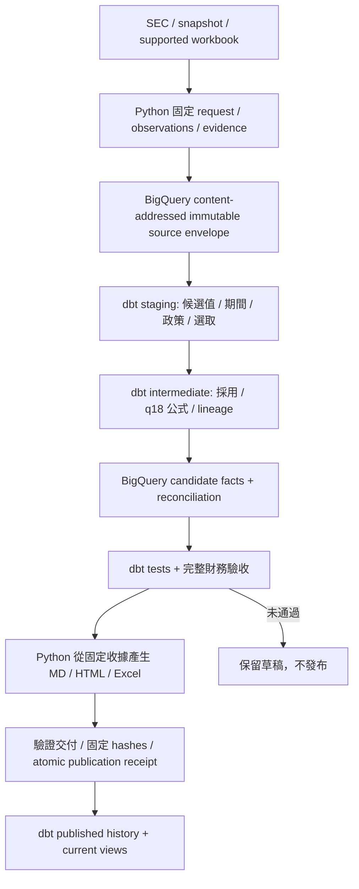

# A → J 全流程：隔離驗證部署

2026-11-11 開始、2026-11-12 更新。使用者選擇「第一項」：在隔離 BigQuery 測試區驗證完整流程，不更動現有正式報告或 BI。發布政策只允許 `SYNTHETIC-ONLY`，production namespace 與真實借款人發布不在此次授權內。

## 已接通的流程



| 節點 | 程式／模型 | 產出及條件 |
| --- | --- | --- |
| A–B | `scripts/loan_review_skill.py::prepare_sources`、`agent_runner.prepare_loan_review_source_stage`；`warehouse_workbook.workbook_bundle` | SEC／snapshot 沿用現有來源 schema；受支援 Nexstar `.xls` 只讀 adapter 保存原始 cells／hash。CIK、scope、實際日期必須一致，未知 CF／定義／歷史可得性保留限制 |
| C | `warehouse_source.source_envelope`、`BigQuerySourceStore.store/load` | `source_bundle_<64位source_id>`，包含 request／所有候選 observations／evidence／reviews／documents；canonical hash 綁定全部內容。明確 REQUIRED schema、WRITE_EMPTY、固定 job ID、寫後完整下載核對。相同內容重用，異內容新 ID |
| C→D | `loan_review_skill.run_skill_review` | 計算實際使用從 C 讀回的 envelope，不直接沿用呼叫者可變物件；manifest 更新真正執行的 source bytes hash |
| D | `stg_review_shadow_inputs/slots`、`dim_review_shadow_configuration/metric_policies`、`int_review_shadow_selection` | 固定 SQL 政策／期間／來源條件；不信任 Python 已選數字或 producer 精度宣告 |
| E | `int_review_shadow_adopted/formula_contracts/calculated`、`shadow_precision.sql` | 原始值、單位與 scale；公式依賴與 evidence；q18 HALF_EVEN 精確除法與逐 Fact audit。來源 provenance 限制進入 SQL acceptance |
| F–G | `fct_review_shadow_facts/reconciliations/acceptance`、`review_shadow_integrity.sql` | 62 kernels／完整 dbt resource tests；必填 Fact 狀態、八項來源綁定對帳、精度／lineage 契約及未解定義。缺件不變零；Quarterly 可用明確完整 LTM 與額外 CF 對帳 slots，不年化 YTD |
| H | `warehouse_candidate.write_preview`、`warehouse_excel` | 同一固定計算收據的 MD／JSON／HTML／Excel；Excel Warehouse 主表只讀 canonical 值，Sources 試算不回寫倉儲 |
| I | `candidate_archive.archive_calculation`、`delivery_archive`、`warehouse_publication.prepare_publication/store` | 重讀／核對實體 BigQuery archive 與 GCS fixed generations；來源、request、計算、release、package、archive attempt、delivery 身份全相符；財務 ready 與必要交付均通過才以單一 WRITE_EMPTY batch 原子寫入發布紀錄／facts／lineage／commit |
| J | `models/published_validation/*`、`publication_validation_integrity.sql` | 獨立檢查實體 C envelope、payload／content hashes、全部身份、gate、必填 facts、八項對帳與完整輸入／證據 bridges。無效批次不進 history；current view 再 JOIN versioned selection 及對應事件 |

## 發布、重試與回退

`published_history_facts` 保留全部有效固定發布。`published_loan_review_facts` 只顯示目前選用的批次；`published_loan_review_lineage` 提供來源與依賴。

`BigQueryPublicationStore.select` 使用 BigQuery transaction／預期 version 更新 current pointer 並追加 selection event。rollback 目標必須曾被選用，歷史發布資料不重寫。stale version 不可覆蓋較新的選擇。

I 已提交但 J 中斷時，以 `--resume-publication <existing-run>` 驗證 pinned receipt／實體批次、部署測試 views，再完成選擇；不重抓來源、不重算、不改交付 hashes。已選用相同批次時不增加 version。提供新來源／設定或改過的收據會拒絕。來源與發布 batch 成功重試也不依賴過期 job metadata，而是重讀實體資料。

報告檔在 commit 前生成並保留候選標示與 hash；其後的驗證發布狀態由獨立 `publication_receipt.json` 決定，不在發布後修改原檔。`published_validation`／exit 0 只代表測試區發布；`draft`／exit 2 代表候選交付成功但不可發布；execution failure 為 exit 1。

## 實際環境與已完成批次

Project `focus-heuristic-438521-v4`、US。

- C：`sec_review_shadow_source_aj_20261111`。
- Candidate archive：`sec_review_shadow_archive_aj_20261111`。
- I／J：`sec_review_shadow_published_aj_20261111`。
- Runtime／delivery GCS：既有 `sec-review-shadow-runtime-20261111-c54e291a`。
- 固定套件 `f46207baba4978a1d608294d33531663995a73cfebc0aeea6332aeee07e483d7`；財務 code hash `eb79714fa8f6a5eea5d09877fcb1e5bb23d4e96b93f823f9399d4e9b7b321de2`，q18 公式未改。新版本加入 source limitations 傳遞與 publication dbt stage 路由。
- Candidate release `aaaaaaaaaaaaaaaaaaaaaaaaaaaaaaaa`；獨立 validation policy `888f77d715ec17be7a497cdc87301bcba44eff9650333d66d6e6f760576c9ea8`，固定 GCS generation／SHA 記錄於 `references/loan-review-runtime.json`。

| 案例 | calculation run | 狀態 | publication ID |
| --- | --- | --- | --- |
| 完整 Quarterly 第一批 | bbcffb89d6604b5c8856dd4a458bfbb0 | A→J 成功；144 Facts、財務 ready、八項對帳通過 | eff3b09fe200421b959a443cd3db2834 |
| 同來源第二批 | f71de7f92b2447428f21119e31b78919 | A→J 成功；曾選用 version 2，回退後留在 history | 321eea2a65f340d1b66d32ceddde835d |
| Annual 缺件 | 1f98c4a159694b0bbbe6b4e15f7d6f76 | report／Excel／archive／GCS 成功，但 debt-service／DSCR 必填缺件，財務驗收 false；沒有發布收據 | 無 |

兩個正向案例使用相同 C source ID `78c7c2a00af0862c0a2dd6d0ba1ae2b12d68e8b97f4783059a591d9dcca46b1c`。合成資料提供明確 source-reported 完整 LTM，不用 YTD 年化或捏造 DEC-03 定義。review 必須包含相同開帳日期的全部來源 IDs；首輪少列時 SQL 如實拒絕，補齊測試覆核後才通過，沒有放寬 gate。

C 首輪載入因未明確傳入 REQUIRED schema 被 BigQuery 拒絕。修正並新增 schema assertion 後，使用新 load-contract job ID 重試同一空來源表；失敗紀錄保留，未覆寫來源。原始證據位於忽略的 `outputs/full_workflow_validation_20261111/`，包含 qualification、control、positive_1（失敗）、positive_1_retry、positive_2、blocked_annual。

## 原生故障、重試與回退結果

2026-11-12 原生 verifier 回傳 `passed`，收據為 `outputs/full_workflow_validation_20261111/verification/verification_receipt.json`。來源與發布重試收據完全不變；兩批歷史每列均保持不變。下列情境實際由 BigQuery／dbt 驗證，並非只有 mock：

| 案例 | 結果 |
| --- | --- |
| Annual 必填財務數字缺件 | published history 為 0 列；沒有發布收據 |
| 缺 commit | SQL gate 拒絕；history／current 不出現該批 |
| Fact 的 source hash 指向其他來源，但重新計算有效 payload／commit hashes | SQL 身份 gate 仍拒絕；current 不變 |
| 外來實體來源表宣稱相同 source ID | C→J 實體檢查拒絕，current 暫停顯示；清理專用故障表後原批次恢復 |
| 過期 selection version | writer 拒絕，不能覆蓋 current |
| 第二批回退第一批 | version 3 指向第一批、144 Facts；history 保留兩批各 144 Facts |

故障注入只清理這次新建的專用故障表，未刪除任何成功來源／發布／歷史。最終 dbt published integrity test 通過，`run_results_sha256=3d2153bfb9f1ff8fee7cb1f3d038b3658a4e7250b7d8a373197463b35cbff772`。

目前 View：`focus-heuristic-438521-v4.sec_review_shadow_published_aj_20261111.published_loan_review_facts`，current 是第一批 `eff3b09fe200421b959a443cd3db2834`、selection version 3。這是測試回退的預期終態。

## 本機驗證與重現入口

2026-11-12：`REVIEW_EXCEL_TEST=1 python -m unittest discover -s tests` 共 379 項通過、沒有略過，包含實際 Excel 匯出／重算。Skill quick validator、shell syntax 與 `git diff --check` 通過。完整 log：`/tmp/sec-full-workflow-excel-20261112.log`。未啟用 Excel 的一輪為 379 項、四項依設定略過，不能用該輪代替 Excel 證據。

在本 branch 使用 `bash scripts/run_loan_review_skill.sh`。自動觸發 skill 的語句是 `give me loan review`；公司、報告類型與實際期間仍須明確，不能將合成測試資料當成指定公司的結果。既有 I 收據的恢復入口：

```bash
bash scripts/run_loan_review_skill.sh --resume-publication outputs/full_workflow_validation_20261111/positive_2
```

這個命令會重新選用第二批；若只是查看測試結果，讀取 manifest／verification receipt 即可，不必執行它。原生故障驗證入口是 `python -m scripts.validate_full_workflow verify --help`；驗證程序會建立專用故障表並清理、追加 rollback event，需使用隔離資源與兩份完整合成發布，不是唯讀命令。

## 範圍限制

### 來源子文件 hash 的修正

J 新增實體 C 驗證後，兩個有效批次曾因 `JSON_QUERY` 的字串表示與 Python canonical JSON 不一致而被攔住。改為 `publication_raw_bundle_v1` 逐字掃描固定 envelope，保留原本 UTF-8 字串、空白、跳脫及數字表示，再計算 bundle SHA256；不經 JSON parse／stringify 或浮點轉換。第一版擷取器漏算 canonical 冒號後的空白，本機測試及原生 gate 都拒絕；修正後重新部署／測試成功。沒有放寬 hash 條件，也沒有改寫原來源或發布資料。新增測試覆蓋巢狀括號、跳脫、中文與數字 lexical bytes。

這是使用者選定的隔離驗證模式，不是 production 切換。SEC 實際抓取沿用既有 adapter；本次原生正向／拒絕案例均為合成來源。workbook 使用既有已知格式的只讀 adapter 和原始 cell fixtures 本機驗證，不能泛稱任意 Excel 都已支援；未知來源可得性與定義必須留在 G 的阻擋條件中。

寫入不可變性由 create-only 方法、固定身份／hash、實體重讀與 view gates 驗證；不宣稱可阻止擁有管理員權限者任意修改資源。測試快照與 GCS 為七日保留，正式 IAM、永久保存、完整 M4 業務案例及正式 consumer 切換仍待後續部署決策。原生 Microsoft Excel 未執行。
